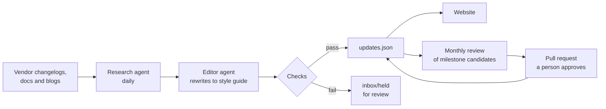

# The Daily Model

A daily paper on the changes in GenAI that matter for system design. Every item says what changed, why it matters, and what to do about it.

**Live:** https://rapidventurelab.github.io/genai-change-radar/

## Who it is for

- **Solution architects** who need to know which changes affect their designs.
- **Engineering and platform leads** who plan around model retirements, pricing changes and new platform features.
- **AI product managers** who track what has become possible.
- **CTOs at smaller companies** without a dedicated team watching vendors.
- **Consultants and pre-sales teams** who need to be current with clients.

## How it works



1. **Every morning** a GitHub Actions workflow runs a research agent. It reads primary sources (vendor changelogs, documentation, engineering blogs) and writes new items to `inbox/<date>.json`.
2. **An editor agent** rewrites each item to the [style guide](docs/STYLE.md). A guard script throws away its edits if it changed anything besides wording.
3. **Checks run.** A style check holds items with banned words, contrast framing or fields over their word limit in `inbox/held/`. Items that pass are merged into `updates.json` and the site rebuilds.
4. **Once a month** another workflow reopens every milestone source to catch broken links, and reviews milestone candidates. Promotions arrive as a pull request. Nothing enters the history until a person merges it.

### Signals and milestones

- **Signals** are the daily items: what changed this week.
- **Milestones** are the history: events that changed what architects can build, or how. Each one passes the four tests in [docs/MILESTONE_RULES.md](docs/MILESTONE_RULES.md) and carries a `verified` date.

The daily agent can only flag a signal as a milestone candidate. Many milestones only become clear once others adopt them, so the monthly review decides with hindsight, and a person approves.

## Quality checks

| Check | When | What happens on failure |
|---|---|---|
| Research agent finished | Daily | The run fails and GitHub emails the owner |
| Editor guard | Daily | The rewrite is discarded, the original wording continues |
| Schema check (vendors, decisions, deadlines) | Daily | The item is held in `inbox/held/` |
| Style check | Daily | The item is held in `inbox/held/` |
| Dataset verification | Daily | The run fails |
| Milestone source links | Monthly | The run fails and GitHub emails the owner |
| Milestone promotion | Monthly | Needs all four tests with evidence, then a person's approval |

## Repository layout

```
index.html, app.js, styles.css, assets/   the website (served by GitHub Pages)
updates.json                              the dataset: every signal and milestone
feed.xml, deadlines.ics, status.json      RSS feed, deadline calendar and scan status, rebuilt daily
s/                                        share pages and LinkedIn preview cards, one per story, rebuilt daily
inbox/                                    daily scan results; held/ for items that failed checks
docs/STYLE.md                             writing guide used by the agents and the style check
docs/MILESTONE_RULES.md                   what counts as a milestone, and how new ones are added
docs/TAXONOMY.md, docs/taxonomy.json      allowed vendors, decisions and action types for filtering
docs/design-system/                       design notes for the current site
audit/                                    audit reports, their data, and monthly review records
scripts/                                  checks and data scripts (no dependencies)
.github/prompts/                          prompts for the research, editor and review agents
.github/workflows/                        the daily run and the monthly review
```

## Run it locally

Requires Node.js 22 or later. There are no dependencies to install.

```bash
npm run check            # style check and dataset checks
npm run check:sources    # reopen every milestone source link
npm run candidates       # list milestone candidates being watched
python3 -m http.server   # then open http://localhost:8000
```

## Feeds

- **RSS:** `feed.xml`, the latest 50 items.
- **Calendar:** `deadlines.ics`, every item with an action deadline. Subscribe to it in Outlook, Google Calendar or Apple Calendar.
- **Open data:** `updates.json`, the full dataset.

## Licence

The stories and data (`updates.json`, the feeds and the story pages) are licensed [CC BY 4.0](https://creativecommons.org/licenses/by/4.0/): reuse them freely, with credit and a link. The code, prompts and design are not licensed for reuse. See [LICENSE.md](LICENSE.md).

## Data policy

`updates.json` holds public-source technology developments only. No private customer information, personal data, credentials or interview notes.

## Built by

Haris Rehman, [Rapid Venture Lab](https://www.rapidventurelab.com/).
